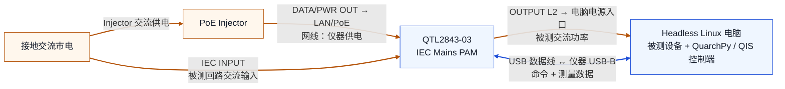

# QTL2843 历史接线：PoE 供电 + USB 通信

QTL2312 的两种设备方案分别见 [M.2 SSD 接线](qtl2312-m2.md)与[显卡 PCIe / 8-pin 接线](qtl2312-gpu.md)。以下保留 2026-11-07 的 QTL2843 实物验证记录。

核实日期：**2026-11-07（UTC）**。

**后续问题补充（2026-11-11）：**使用者反馈，QTL2843 通过 Tenda PoE30G-AT 供电正常、USB 通信正常，
但 `DATA IN` 接 BUFFALO 交换机或直连 Dell Precision 5820 的 Linux 网卡时，Ethernet 均未建立物理链路。
`eno1` 持续报告 `NO-CARRIER` / `Link detected: no`，现有排查尚未解决。
完整接线、七项已做排查及未确认原因见 [Ethernet 问题记录](known-limitations.md#qtl2843-ethernet)。
本页的 USB 可用记录不代表 Ethernet 已验证可用。

实物接线由使用者确认：仪器连接 PoE Injector 的 `DATA/PWR OUT`，仪器 `INPUT` 接插座，电脑电源接仪器 `OUTPUT L2`，电脑与仪器另用 USB 数据线连接。USB 身份查询和普通用户访问权限由本机实际检查确认。

## 接线简图

橙色线路为供电路径，蓝色线路为 USB 命令与数据路径。[可编辑的 Mermaid 源文件](../diagrams/current-wiring.mmd)与下图保持一致；GitHub 可以直接渲染此 Markdown 图。



## 每条线的作用

| 从哪里 | 接到哪里 | 本次用途 |
| --- | --- | --- |
| 接地交流市电 | QTL2843 的 IEC `INPUT` | 提供流经测量通道、最终供给电脑的交流电 |
| QTL2843 的 `OUTPUT L2` | 被测电脑的交流电源入口 | 测量电脑的交流输入功率 |
| 交流市电 | PoE Injector 的供电输入 | 为 Injector 供电 |
| Injector 的 `DATA/PWR OUT` | QTL2843 的 `LAN/PoE` 网口 | 本方案用于给仪器自身供电 |
| 电脑的 USB 主机端口 | QTL2843 的 USB-B 接口 | 控制、设备身份查询及测量数据传输 |

这里的 PoE 是仪器自身的电源；电脑所用的交流电来自仪器的 IEC `INPUT → OUTPUT L2` 回路。三路 `L1/L2/L3` 是此单相 IEC Mains PAM 的三个测量输出口，不应因为 USB 描述符写着 `3-Phase PAM` 就把实物认作三相设备。[厂商手册，第 12–15 页](https://quarch.com/wp-content/uploads/2024/09/QTL2843-IEC-Mains-PAM-Technical-Manual-1.pdf)

Injector 的 `DATA IN` 只有使用 LAN 控制时才需要接入数据网络；本次通过 USB 控制，不依赖交换机、DHCP 或电脑与仪器处于相同 IP 网段。其是否还保留了交换机连线，未作新的实物确认，因此没有作为必需连接画入简图。

## 当前设备与通信状态

| 项目 | 本机实测 |
| --- | --- |
| USB VID:PID | `16d0:0449` |
| USB 描述符名称 | `3-Phase PAM`；`lsusb` 可能同时显示厂商登记名 `MCS` |
| `hello?` 返回 | `IEC Mains PAM` |
| `*IDN?` 的 Part# / Serial# | `QTL2843-03` / `QTL2843-03-002` |
| 固件 / FPGA | `5.119` / `QTL2848,1.1` |
| 连接目标 | 原生 USB：`USB:QTL2843-03-002`；QIS：`USB::QTL2843-03-002` |
| 2026-11-07 的 USB 节点示例 | `/dev/bus/usb/001/007`，用户 `ubuntu` 可读写 |
| USB 拓扑 | 主机 USB 根控制器端口直连，协商速度 `480M` |
| 检查时录制状态 | `rec?` 返回 `OFF` |

USB 节点曾是 `001/006`，重插后变成 `001/007`。节点号只是当时的枚举结果；程序应通过设备序列号连接，权限也应使用 udev 规则匹配，见 [USB 注意事项](usb-notes.md)。

此前网络调试留下的电脑有线地址为 `192.168.1.10/24`；本次检查 `eno1` 为 `DOWN`。仪器查询返回 LAN 地址 `192.168.1.99`、DHCP `DISABLED`。这些是 LAN 配置，不是 USB 通信参数，也不表示 LAN 链路当前连通。

## 软件与测量范围

当前链路为：

```text
本机 Python / QuarchPy → 本机 headless QIS → USB → QTL2843
```

QIS 的 headless 模式已验证。QPS 没有在此方案中启动；QPS 的图形分析和区间能耗统计接口不能直接当作 QIS 接口调用。[QIS 官方介绍](https://quarch.com/products/quarch-instrument-server/)

电脑同时是控制端和被测端，所以记录到的是它在运行当时的**整机交流输入功率**，包含电源转换损耗及采集程序造成的额外负载。该接线不是单独测量 CPU、GPU 或某条直流电源轨。

PoE Injector 在图中从测量回路以外取电，因此它自身的交流功耗不计入 `L2`。若以后改变接线，把 Injector 也接到被测输出口，能耗边界将随之改变。

## 接线时的限制

- 改动电源接线前，应按厂商手册断开相应电源；仪器和电脑使用合适的接地电源与额定线缆。
- 当前已经使用 PoE 供电，不要再同时接入独立 12V 电源。厂商要求这两种仪器供电方式一次只连接一种。
- 手册 v1.4 给出的 `L1/L2/L3` 三路输出合计上限为 **10A**，不是每路各 10A；以实物铭牌和适用版本手册为准。
- USB 传输和插拔、权限、占用及测量扰动的处理见 [USB 注意事项](usb-notes.md)。

上述电源接口、供电方式和额定限制依据 [QTL2843 技术手册](https://quarch.com/wp-content/uploads/2024/09/QTL2843-IEC-Mains-PAM-Technical-Manual-1.pdf)。
