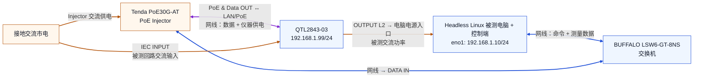
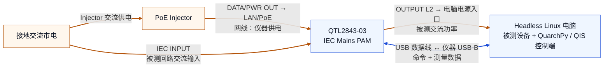

# 接线说明：当前 Ethernet 与备用 USB

本文针对 QTL2843。QTL2312 的其他方案见 [M.2 SSD 接线](qtl2312-m2.md)与
[显卡 PCIe / 8-pin 接线](qtl2312-gpu.md)，各自的供电和测量通道不同。

当前接线核实日期：**2026-11-25（UTC）**。电脑和 QTL2843 通过交换机、PoE Injector 通信，
USB 已拔掉；已完成网络身份查询、1000 Hz / 30 秒采集和网线拔插后的通信验证。
同一台 Linux 电脑既是被测设备，也是 QuarchPy / headless QIS 控制端。

**原有 USB 方法完整保留在本文后半部分及安装、使用指南中**，网络失联时仍可接回 USB 查询。
Ethernet 的配置与命令见 [网线通信指南](ethernet.md)，本次问题如何恢复见 [排查记录](../troubleshooting/ethernet-recovery-20261125.md)。

## 1. 当前 Ethernet 接线

橙色是交流供电，蓝色是网络数据，紫色网线同时传输数据与 PoE 仪器供电。
[当前接线图源码](../diagrams/current-wiring.mmd)与下图一致。



| 从哪里 | 接到哪里 | 作用 |
| --- | --- | --- |
| 被测电脑 `eno1` | 交换机 | 命令和测量数据，电脑为 `192.168.1.10/24` |
| 交换机 | Injector `DATA IN` | 普通 Ethernet 数据接入 |
| Injector `PoE & Data OUT` | QTL2843 `LAN/PoE` | 同时传输数据和仪器供电 |
| 交流插座 | Injector 电源输入 | 为 Injector 供电 |
| 交流插座 | QTL2843 `INPUT` | 被测交流回路输入 |
| QTL2843 `OUTPUT L2` | 被测电脑电源入口 | 测量电脑的整机交流输入功率 |

Injector 两个网口都插网线是正确接法。`DATA IN` 接交换机，`PoE & Data OUT` 接仪器。
交换机为 BUFFALO LSW6-GT-8NS，Injector 为 Tenda PoE30G-AT。
当前没有 DHCP 服务器，仪器为 `192.168.1.99/24`、DHCP 关闭，TCP 命令端口为 `9760`。
USB 当前不连接，Wi-Fi 只保留原来的上网路由，访问仪器经 `eno1`。

软件链路为：

```text
本机 Python / QuarchPy → 本机 headless QIS → eno1 → 交换机 → Injector → QTL2843 LAN
```

只测试网线重连时，拔交换机与 Injector `DATA IN` 之间的网线；保持 Injector 供电及
`PoE & Data OUT → QTL2843` 连接不动。仪器断电后地址是否保留尚未验证。

## 2. USB 接线与操作（保留）

以下是 **2026-11-07（UTC）**已经验证的 USB 方案。仪器由 Injector 的 `DATA/PWR OUT` 供电，
仪器 `INPUT` 接插座、电脑电源接 `OUTPUT L2`，电脑与仪器另接 USB 数据线。
USB 身份查询和普通用户访问权限已经过本机检查。

### USB 接线简图

橙色为供电，蓝色为 USB 命令与数据。[USB 接线图源码](../diagrams/usb-wiring.mmd)与下图一致；
该图画出 USB 模式所需的连接，既有交换机和 `DATA IN` 网线可以继续保留。



### USB 方案每条线的作用

| 从哪里 | 接到哪里 | 本次用途 |
| --- | --- | --- |
| 接地交流市电 | QTL2843 的 IEC `INPUT` | 提供流经测量通道、最终供给电脑的交流电 |
| QTL2843 的 `OUTPUT L2` | 被测电脑的交流电源入口 | 测量电脑的交流输入功率 |
| 交流市电 | PoE Injector 的供电输入 | 为 Injector 供电 |
| Injector 的 `DATA/PWR OUT` | QTL2843 的 `LAN/PoE` 网口 | 本方案用于给仪器自身供电 |
| 电脑的 USB 主机端口 | QTL2843 的 USB-B 接口 | 控制、设备身份查询及测量数据传输 |

这里的 PoE 是仪器自身的电源；电脑所用的交流电来自仪器的 IEC `INPUT → OUTPUT L2` 回路。三路 `L1/L2/L3` 是此单相 IEC Mains PAM 的三个测量输出口，不应因为 USB 描述符写着 `3-Phase PAM` 就把实物认作三相设备。[厂商手册，第 12–15 页](https://quarch.com/wp-content/uploads/2024/09/QTL2843-IEC-Mains-PAM-Technical-Manual-1.pdf)

USB 控制不依赖交换机、DHCP 或相同 IP 网段；`DATA IN` 未连接也能通过 USB 控制。
当前 Ethernet 接线中可以保留交换机网络，接回 USB 后正常退出原采集服务，再用
`--device USB::QTL2843-03-002` 启动 USB 服务。不要同时用两个采集程序操作同一台仪器。

### USB 设备识别与历史验证状态

| 项目 | 本机实测 |
| --- | --- |
| USB VID:PID | `16d0:0449` |
| USB 描述符名称 | `3-Phase PAM`；`lsusb` 可能同时显示厂商登记名 `MCS` |
| `hello?` 返回 | `IEC Mains PAM` |
| `*IDN?` 的 Part# / Serial# | `QTL2843-03` / `QTL2843-03-002` |
| 固件 / FPGA | `5.119` / `QTL2848,1.1` |
| 连接目标 | 原生 USB：`USB:QTL2843-03-002`；QIS：`USB::QTL2843-03-002` |
| 2026-11-07 的 USB 节点示例 | `/dev/bus/usb/001/007`，用户 `ubuntu` 可读写 |
| USB 拓扑 | 主机 USB 根控制器端口直连，协商速度 `480M` |
| 检查时录制状态 | `rec?` 返回 `OFF` |

USB 节点曾是 `001/006`，重插后变成 `001/007`。节点号只是当时的枚举结果；程序应通过设备序列号连接，权限也应使用 udev 规则匹配，见 [USB 注意事项](usb-notes.md)。

2026-11-07 的 USB 验证期间，电脑 `eno1` 曾为 `DOWN`，仪器 LAN 查询返回 `192.168.1.99`、
DHCP `DISABLED`。这是历史状态，不表示今天的 LAN 不通；IP 参数也不影响 USB 通信。

### USB 软件链路

USB 方案链路为：

```text
本机 Python / QuarchPy → 本机 headless QIS → USB → QTL2843
```

QIS 的 headless 模式已验证。QPS 没有在此方案中启动；QPS 的图形分析和区间能耗统计接口不能直接当作 QIS 接口调用。[QIS 官方介绍](https://quarch.com/products/quarch-instrument-server/)

USB 的安装、udev 权限和原生查询见[安装指南](installation.md)，故障处理见[USB 注意事项](usb-notes.md)。
原有 USB `serve/start/stop` 例子保留在[使用指南](../usage/command-controlled-capture.md)。

## 3. 两种方案共有的测量范围

电脑同时是控制端和被测端，所以记录到的是它在运行当时的**整机交流输入功率**，包含电源转换损耗及采集程序造成的额外负载。该接线不是单独测量 CPU、GPU 或某条直流电源轨。

PoE Injector 在图中从测量回路以外取电，因此它自身的交流功耗不计入 `L2`。若以后改变接线，把 Injector 也接到被测输出口，能耗边界将随之改变。

## 4. 接线时的限制

- 改动电源接线前，应按厂商手册断开相应电源；仪器和电脑使用合适的接地电源与额定线缆。
- 当前已经使用 PoE 供电，不要再同时接入独立 12V 电源。厂商要求这两种仪器供电方式一次只连接一种。
- 手册 v1.4 给出的 `L1/L2/L3` 三路输出合计上限为 **10A**，不是每路各 10A；以实物铭牌和适用版本手册为准。
- USB 传输和插拔、权限、占用及测量扰动的处理见 [USB 注意事项](usb-notes.md)。

上述电源接口、供电方式和额定限制依据 [QTL2843 技术手册](https://quarch.com/wp-content/uploads/2024/09/QTL2843-IEC-Mains-PAM-Technical-Manual-1.pdf)。
