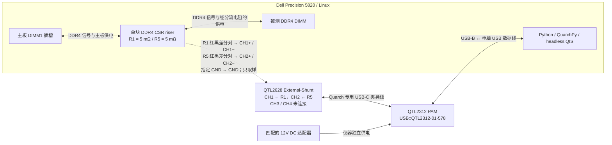
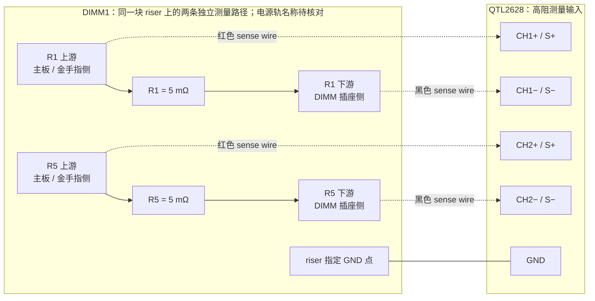

# DIMM1 DDR4：QTL2312 + QTL2628 接线与测量原理

本页记录 **2026-11-27 用户确认的实际配置**：Dell Precision 5820、DIMM1 中一块 DDR4 CSR riser，
只连接 R1、R5 两个 5 mΩ 分流电阻。物理接线依据用户描述；仪器身份、阻值读回和采集链路已在本机验证。
软件安装、实时读数、CSV 和能耗命令见[DRAM 操作与测试指南](../usage/dram-shunts.md)。

## 设备与连接

| 部件 | 本次配置 / 仪器返回 |
| --- | --- |
| 被测对象 | DIMM1 的一条 DDR4 内存，安装在单块 CSR riser 上 |
| 控制器 | QTL2312-01；连接目标 `USB::QTL2312-01-578` |
| 控制器内部序列号 | `QTL2098-02-583`，不用于替代 USB 连接目标 |
| 外部分流夹具 | QTL2628-03，序列号 `QTL2628-03-004` |
| 仪器供电 | QTL2312 匹配的外置 12V DC 适配器 |
| 主机通信 | QTL2312 USB-B 口经 USB 数据线接 Linux 电脑 |
| 夹具通信 | QTL2628 经 Quarch 专用 USB-C 夹具线接 QTL2312 Fixture 口 |
| 未使用接口 | QTL2628 CH3、CH4，Digital IN、Digital OUT |

DIMM 的供电仍来自主板，经 riser 的分流电阻进入 DIMM；QTL2628 测量这些供电路径，
QTL2312 的适配器不为 DIMM 供电。本次主机同时运行被测任务和采集软件。
这套 DRAM 接线不使用 PoE Injector；QTL2843 的整机交流接线另见[原有指南](current-wiring.md)。



图源：[qtl2312-dram-wiring.mmd](../diagrams/qtl2312-dram-wiring.mmd)。
USB-B 主机通信口、USB-C 夹具口和 12V 供电的用途见[Quarch QTL2312 产品页](https://quarch.com/products/power-analysis-module/)。
专用 USB-C 夹具线只连接匹配的 PAM 与夹具，不接电脑的普通 USB-C 口。

## 实际接线表

| QTL2628 端子 | 软件通道 | riser 电阻 | nominal 阻值 | 红线 S+ | 黑线 S− |
| --- | --- | --- | --- | --- | --- |
| CH1 / POWER_1 | `POWER_1` | DIMM1 R1 | 5 mΩ = 0.005 Ω | R1 上游 → CH1+ | R1 下游 → CH1− |
| CH2 / POWER_2 | `POWER_2` | DIMM1 R5 | 5 mΩ = 0.005 Ω | R5 上游 → CH2+ | R5 下游 → CH2− |
| CH3 / POWER_3 | 不使用 | 未连接 | 不适用 | 不接 | 不接 |
| CH4 / POWER_4 | 不使用 | 未连接 | 不适用 | 不接 | 不接 |

上游是主板／金手指侧，下游是 DIMM 插座侧。两组红黑线分别跨在各自电阻两端，
属于差分取样线；DIMM 的工作电流经过 PCB 和电阻，不经过这些 sense wire。
另外用单独一根线把 riser 的指定 GND 点接 QTL2628 GND，作为对地电压参考，不用 S− 代替。

## 电路连接与电阻作用

下图是依据上述接线画出的测量原理图，**不是 CSR 厂商原理图**，不表示已验证 R1、R5 对应的电源轨名称或完整供电覆盖。
两条路径分别测量，没有把 R1 和 R5 串接起来，也没有把 CH1−、CH2−接地。



图源：[dram-shunt-circuit.mmd](../diagrams/dram-shunt-circuit.mmd)。
[Quarch QTL2628 产品页](https://quarch.com/products/external-shunt-pam-fixture/)说明，夹具可同时接最多四个外部分流电阻，由电阻压降计算电流；本次只接其中两路。

| 电阻 | 当前用途 | 已知与未知 |
| --- | --- | --- |
| R1，5 mΩ | 串在该测量路径中，以微小压降换算通过它的电流，记录为 CH1/R1 | 阻值由用户提供；软件读回确认配置为 5 mΩ；实际电阻精度及电源轨待核对 |
| R5，5 mΩ | 与 R1 相同的取样原理，独立记录另一条路径，记录为 CH2/R5 | 保留实物标号 R5；不能因草稿写 R6 就改名或标为 VPP |

这些是低阻值电流取样电阻，不是给测量软件设置功率上限的元件。此处只记录已确认的 R1、R5；
没有其余 PCB 电阻的原理图、阻值和用途资料，不作推断。
草稿手册将 R1 标为 VDD、R6 标为 VPP，但本板第二电阻为 R5；在本板原理图或断电连通性核对完成前，
软件中两路的 `rail` 均保留 `null`，以 R1、R5 为准。

### 电压、电流、功率分别表示什么

```text
V_shunt = V(S+) − V(S−)
I_R1 = V_shunt_R1 / 0.005 Ω
I_R5 = V_shunt_R5 / 0.005 Ω
P_shunt_loss = I² × 0.005 Ω = V_shunt × I
Tot_power_W = POWER_1 的 QIS 功率 + POWER_2 的 QIS 功率
E_J = Σ(每个输出区间的平均功率_W × 区间长度_s)
E_Wh = E_J / 3600
```

例如压降 1 mV 对应电流 0.2 A。若对应供电电压为 1.2 V，近似稳态路径功率为 0.24 W；
电阻自身损耗仅为 0.0002 W。这是计算示例，不是 R1/R5 电源轨或现场读数。
电流 1 A 时，5 mΩ 电阻产生 5 mV 压降、5 mW 损耗；要核对其额定功率及对 DIMM 供电的影响。

`measured_voltage_V` 是仪器输出的对地电压；`shunt_voltage_V` 是电阻两端的差分压降，
两者不同。未获得本板完整原理图及夹具电压取样点确认前，不将对地电压自行解释为某个已验证的 VDD/VPP 节点。
QIS 用其电压和电流计算路径功率，再对输出区间求平均；程序保留该功率用于能耗积分。
有波动时，平均电压乘平均电流不等于平均功率；区间平均 CSV 也不能完整恢复区间内的瞬态。

本次 `Tot` 仅为已接 CH1+CH2 的路径功率之和，不是分流电阻自身损耗之和，
也不能直接宣称是全部 DRAM、全部 DIMM 或整机功率。完整供电覆盖和电压取样侧仍待核实。

## 接线和测量注意事项

1. **断电后改硬件**：插拔 DIMM、riser、sense wire 或改焊点之前关闭主机并断开电源；不在带电 PCB 上用电阻／蜂鸣档测试。先完成固定和绝缘，再上电。
2. **逐路核对**：R1 两端只接 CH1+、CH1−，R5 两端只接 CH2+、CH2−。保留 S+ 上游、S− 下游的方向，避免跨错焊盘、虚焊及露铜短接。
3. **S− 不是地**：不要把两个负差分输入相连，也不要短接到 GND。GND 用指定地焊点单独连接；黑线颜色本身不代表地。
4. **保持 sense wire 短且成对**：减少取样回路，适当绞合并固定，避免拉扯焊点；核对端子夹紧、绝缘和机箱内空间。riser 还可能改变信号完整性和散热条件，实验间应保持安装一致。
5. **5 mΩ 不是软件测得的真值**：读回 `5 milliOhm` 只证明仪器配置成功。普通两线万用表的表笔／接触电阻可超过 5 mΩ；校准值宜用合适的四线低阻测量方法，在断电并排除并联路径影响后取得，保留测量条件及误差。
6. **保留符号和原始量**：负电流可能来自取样方向、零点或实际反向电流，先检查，不取绝对值掩盖问题。确认对地电压与已核实的电源节点相符，再解释路径功率；原始压降、电阻公差、接触和温漂都会影响结果。
7. **只使用两路**：CH3/CH4 未连接，不将悬空输入读数纳入 `Tot`。先前配置过的 CH3/CH4 阻值参数不表示存在实物接线；启动常驻服务必须带 `--active-channels POWER_1 POWER_2`。
8. **软件独占仪器**：独立采集、常驻服务和 QuarchPy terminal 不同时占用仪器；先结束自己的测量再关闭服务。QPS 不需启动。USB 重插会中断当次采集，重连后开始新段，不能把断线前后当成连续数据。
9. **控制实验干扰**：本机同时运行负载与 QIS，采集计算和写 CSV 也会用到 CPU、内存及磁盘。比较 SQL 时保持采样间隔、CSV 开关、线程数、缓存、温度和后台任务一致，先记录空闲基线；不要把短时波动直接解释为某条电源轨的异常。

## 上电前后怎样核对

断电时，按本板原理图／焊盘连通性确认 R1/R5、上下游、GND 以及所有 DIMM 供电路径是否覆盖；
记录实物照片、riser 版本、阻值来源、公差和可能的旁路。当前仓库尚无 CSR 原理图或已验证的 R5 电源轨映射。

上电后先检查 Linux 正常识别内存，再按[软件验证步骤](../usage/dram-shunts.md#建议的测试顺序)
核对仪器、5 mΩ 配置、时间戳和两路独立数据。小规模静息／内存访问负载对比可检验读数是否随任务变化，
但不能替代已知参考仪表、已知电流负载和实际阻值的精度校验。断电／重新连接后，应再次读取阻值，不假定配置永久保存。
