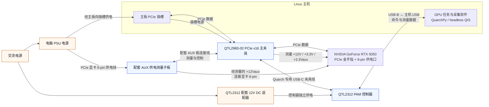

# QTL2312 + QTL2983：显卡 PCIe 与 8-pin 功耗测量接线

核实日期：**2026-11-11（UTC）**。本方案用 QTL2983 主夹具测量 PCIe 插槽供电，用配套 AUX 子板测量显卡外接供电，两部分通过同一台 QTL2312 采集。

用户确认 RTX 5050 已连接 PCIe 和 8-pin 测量模块；本机已查询到夹具身份、各路电压/电流/功率，并完成采集。
下图按厂商拓扑和本次配置绘制。AUX 子板的完整料号、具体端口布局和每根实物线缆尚未逐一核实，应按所配子板的标识连接；当前功率比对仍有[待核查项](#测量边界与待核查项)。

## 已识别的组件

| 组件 | 本机确认的信息 |
| --- | --- |
| 控制器 | QTL2312-01，连接目标 `USB::QTL2312-01-578`，固件 5.124 |
| 主夹具 | `Gen5 x16 AIC PAM Fixture with AUX Power`，Part# `QTL2983-02` |
| 夹具序列号 / 内部编号 | `QTL2983-02-002` / `QTL2631-02-012` |
| AUX 子板 | 用户确认接入 8-pin 供电测量；具体子板版本待按实物确认 |
| 显卡 | NVIDIA GeForce RTX 5050，PCI ID `10de:2d83`，MSI 子系统 |
| Linux 主机 | 同时运行 GPU 任务、QuarchPy 和 headless QIS |

QTL2983 是支持外接辅助电源的 PCIe 夹具系列，AUX 板有不同供电接口版本；型号中的 Gen5 表示夹具能力，不代表本机已经协商到 Gen5。本次系统报告的链路为 PCIe Gen4 ×8。
系列与版本说明见 [Quarch 官方产品页](https://quarch.com/products/gen5-pcie-x16-pam-fixture-with-aux-power-gpu-ai-analysis/)。

## 接线步骤

更换 PCIe、显卡供电或夹具连接前，先结束采集并关闭主机电源，再按厂商手册操作。

1. **主板 → 主夹具 → 显卡**：将 QTL2983 主夹具插入兼容的 PCIe 插槽，将显卡金手指插入夹具的设备侧插槽并固定。PCIe 数据和插槽供电都经过主夹具。
2. **PSU → AUX 子板 → 显卡 8-pin**：把 PSU 的 PCIe 显卡供电线接到 AUX 子板的供电侧，再用匹配线缆从子板设备侧接到显卡 8-pin。使用与 PSU、子板及显卡匹配的线缆，按端口标识区分两侧。需要测量的外接供电必须经过 AUX 子板。
3. **AUX 子板 ↔ 主夹具**：使用配套连接线，将 AUX 子板接回 QTL2983 的 AUX board connection 接口。只有 8-pin 供电线还不能组成完整的测量数据链路。
4. **主夹具 ↔ QTL2312**：使用 Quarch 专用 USB-C 夹具线连接主夹具和控制器 Fixture 接口。主夹具这个 USB-C 口只连接 PAM 控制器。
5. **适配器 → QTL2312**：用匹配的 12V DC 适配器独立给控制器供电。显卡负载电源仍来自电脑 PSU 和主板插槽。
6. **QTL2312 ↔ Linux**：控制器 USB-B 口通过 USB 数据线接到 Linux 主机，QuarchPy/QIS 负责配置和读取仪器。

本方案不需要 PoE Injector 或 QTL2843。QTL2312 主机 USB 通信口、主夹具 USB-C 口、AUX 板连接口各有用途，应按标识连接。
主夹具 USB-C 与 AUX 接口位置见 [QTL2312 技术手册 Annex A.9，第 60–64 页](https://quarch.com/wp-content/uploads/2020/08/QTL2312-Power-Analysis-Module-Technical-Manual.pdf#page=60)。
控制器供电与接口见 [PAM 官方说明](https://quarch.com/products/power-analysis-module/)。

## 接线示意图

此图表示供电、PCIe 数据及仪器通信的逻辑关系；主机与显卡的实际摆放以机械安装为准。



图源：[qtl2312-gpu-wiring.mmd](../diagrams/qtl2312-gpu-wiring.mmd)。

## 通道与测量范围

以下名称来自本机夹具 XML；开头的 `+` 是通道名的一部分。

| `--channel` | 对应路径 |
| --- | --- |
| `+12V` | PCIe 插槽 12V 供电 |
| `+3.3V` | PCIe 插槽 3.3V 供电 |
| `+3.3Vaux` | PCIe 插槽 3.3V 辅助供电 |
| `+12Vaux` | 经 AUX 子板测量的外接 12V 供电；本次为显卡 8-pin |
| `Tot` | 上述四路功率的合计 |

```text
PCIe 插槽合计 = +12V + +3.3V + +3.3Vaux
Tot = PCIe 插槽合计 + +12Vaux
```

`+3.3Vaux` 属于插槽供电，显卡 8-pin 对应 `+12Vaux`。`Tot` 是所测四路之和，不能再把各分路加到 `Tot` 上。
如果使用具有多个外接电源口的显卡，应保证所有目标供电路径都进入匹配的 AUX 测量配置，并核实其合计通道定义。

## 连接后的读取验证

先按[安装指南](installation.md)准备 QuarchPy、QIS 和 [QTL2312 USB 权限规则](../../config/udev/99-quarch-qtl2312.rules)。
更换夹具后，结束原测量并重启空闲采集服务，让程序重新发现通道。独立检查、固定时长采集与常驻服务不要同时占用同一仪器。

在仓库根目录、常驻服务停止时检查身份与通道：

```bash
./bin/Quarch --device USB::QTL2312-01-578 --inspect
```

应返回 `QTL2983-02`、上表五个通道以及 `device_record_state: OFF`。随后可独立采集当前状态 30 秒，每 100 ms 输出一点：

```bash
mkdir -p results/gpu
./bin/Quarch --device USB::QTL2312-01-578 --channel Tot \
  --seconds 30 --resample 100ms --output results/gpu/check-30s.csv
```

正常完整输出为 **300 点**。结果包含总功率 CSV、全部通道 `check-30s.all-channels.csv` 和能耗 JSON。
该命令只采集当前功耗；需要测矩阵计算时，先启动持续 GPU 任务，待负载稳定后再采集。重复测量要更换输出文件名，程序拒绝覆盖已有结果。

实时查看使用常驻服务；已有服务时跳过 `serve`：

```bash
# 终端 1
./bin/Quarch serve --device USB::QTL2312-01-578 --channel Tot --resample 100ms --csv off

# 终端 2：Ctrl+C 停止本次查看；服务保留
./bin/Quarch watch --channel Tot --100ms
# 也可单独查看 8-pin
./bin/Quarch watch --channel +12Vaux --100ms
```

`serve` 的 `--resample` 决定普通分段采集的输出间隔；`watch` 的间隔只对本次查看生效，退出后恢复服务默认值。
未指定间隔时程序默认 **10 ms / 100 Hz**；本次还验证了 **100 ms / 10 Hz** 和 **500 ms / 2 Hz**。
夹具模拟通道基础采样率为 250 kHz；这些较慢的输出是时间窗平均功率，不代表硬件每 100 ms 才测一次电压、电流。
CSV 开关和分段能耗统计见[使用指南](../usage/command-controlled-capture.md)，采样能力见[厂商说明](https://quarch.com/products/gen5-pcie-x16-pam-fixture-with-aux-power-gpu-ai-analysis/)。

## 与 SSD 方案的区别

| 项目 | M.2 SSD | 当前显卡 |
| --- | --- | --- |
| 夹具 | QTL2980 M.2 | QTL2983 PCIe 主夹具 + AUX 子板 |
| 数据连接 | 主板 M.2 → 夹具 → SSD | 主板 PCIe → 主夹具 → 显卡 |
| 供电测量 | 经 M.2 夹具的 SSD 电源轨 | 经主夹具的插槽电源 + 经 AUX 子板的外接电源 |
| 通道示例 | `3.3V`、`VIO_1V8`、`Tot` | `+12V`、`+3.3V`、`+3.3Vaux`、`+12Vaux`、`Tot` |
| 控制器与采集软件 | QTL2312、USB、QuarchPy/QIS | 复用同一套 |

本次显卡读取复用了现有通道发现、CSV 和积分代码，未修改采集核心。矩阵负载程序负责让 GPU 计算，与仪器读取是两部分。
仅读取 Quarch 功耗不依赖 NVIDIA 驱动；本次运行 CUDA 负载时已安装并验证 NVIDIA Open 595.99.02 驱动。
SSD 的原接线见 [QTL2312 M.2 指南](qtl2312-m2.md)。

## 测量边界与待核查项

Quarch 数值覆盖夹具实际测到的电源轨，包括显卡在该窗口内的基础功耗；不包括 PSU 的交流转换损耗或 QTL2312 适配器耗电。要将合计解释为完整显卡供电功耗，还需要确认所有物理供电路径均经过相应测量部分。

2026-11-11 的 30 秒矩阵负载短测中，Quarch 合计均值约 **105.639 W**（插槽约 0.612 W、外接供电约 105.026 W），NVIDIA 自报功率约 **130 W**。单位、连续样本和分路求和已核对，但差异原因尚未确认。
随后从 30–32°C 开始的三次独立复测，Quarch 均值为 **108.652 W**、轮间变异系数 **0.0821%**，
NVIDIA 遥测仍约 130 W。首次测试从 45°C 开始，单独保留，不纳入这三次统计。
静息、首次负载、复测的原始 CSV 和方法见[显卡实验归档](../../experiments/2026-11-11-rtx5050-gpu/README.md)。
夹具身份正常、有读数以及 `Tot` 等于分路和，均不能单独证明每条实物供电路径已完全覆盖或两套功率测量已经一致。后续需核对插槽与 AUX 供电走线、夹具配置及校准；本页不把差异归因于某个已确认故障。
