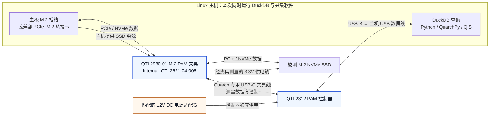

# QTL2312 + M.2 PAM：Linux 采集环境

核实日期：2026-11-09（UTC）。本页记录当前工作站的实际通信和采集验证；[QTL2843 整机交流接线](current-wiring.md)属于此前的另一套方案。

2026-11-11 更换为显卡夹具后的连接方式见 [QTL2312 + QTL2983 显卡接线](qtl2312-gpu.md)。本页保留 M.2 SSD 的接线与通道定义。

## 已识别的设备

| 项目 | 设备返回值 |
| --- | --- |
| USB VID:PID | `16d0:0449` |
| QIS 连接目标 | `USB::QTL2312-01-578` |
| 控制器 Part# / Enclosure# | `QTL2312-01` / `QTL2312-01-578` |
| 控制器内部 Serial# | `QTL2098-02-583`（不要用于替代 USB 连接目标） |
| 控制器固件 / FPGA | `5.124` / `QTL2103,1.12` |
| 夹具名称 | `Gen5 Vertical M.2 PAM Fixture` |
| 夹具 Part# / Serial# | `QTL2980-01` / `QTL2980-01-225` |
| 夹具 Internal# / FPGA | `QTL2621-04-006` / `QTL3415,1.1` |

此前待确认的 **QTL2621 是本夹具返回的内部编号**；产品型号已由仪器确认是 **QTL2980-01**。
这些信息来自 `*IDN?`、`fix:identity?`、`fix:channels?` 和 `fix:chan:xml?`。
USB 枚举和实测数据可确认控制器、夹具和测量链路工作；不能仅由这些查询判断主板具体型号或被测 SSD 的型号。

## 组件连接与测量路径

先关闭主机电源，按夹具手册完成插接和机械固定，再上电检查身份。连接步骤如下：

1. **主板 → 夹具**：把 QTL2980 的主机侧金手指插入主板 M.2 插槽，或兼容的 PCIe–M.2 转接卡。
2. **夹具 → SSD**：把被测 M.2 NVMe SSD 插入夹具的 SSD 接口并固定。NVMe 数据经夹具透传，SSD 电源也经过夹具的测量路径。
3. **夹具 → QTL2312**：用匹配的 Quarch USB-C 夹具线连接夹具和 QTL2312 的 Fixture 接口。这个夹具接口只连接 PAM 控制器，不能插到电脑的普通 USB-C 口。
4. **适配器 → QTL2312**：使用与控制器匹配的 12V DC 电源适配器独立供电。SSD 的被测供电来自主板侧；控制器适配器不是这里的 SSD 供电来源。
5. **QTL2312 → Linux**：用 USB 数据线连接控制器 USB-B 口与 Linux 电脑，QuarchPy 经 QIS 配置仪器并接收测量数据。

QTL2312 是通过外置夹具测量主机供电的 PAM。USB-C 夹具口与 USB-B 主机通信口功能不同，
本方案不需要 PoE Injector 或 QTL2843。接线依据：[官方 PAM 产品说明](https://quarch.com/products/power-analysis-module/)、
[QTL2312 技术手册（QTL2980 夹具见 Annex A.8）](https://quarch.com/wp-content/uploads/2020/08/QTL2312-Power-Analysis-Module-Technical-Manual.pdf)。



图源：[qtl2312-m2-wiring.mmd](../diagrams/qtl2312-m2-wiring.mmd)。

| 路径 | 传输内容 | 在本次实验中的作用 |
| --- | --- | --- |
| 主板 ↔ 夹具 ↔ SSD | PCIe/NVMe 请求与数据 | DuckDB 从 SSD 读取数据库 |
| 主板 → 夹具 → SSD | SSD 供电 | 夹具测量选定电源轨的电压、电流和功率 |
| 夹具 ↔ QTL2312 | Quarch 专用夹具通信 | 控制夹具并传输测量数据 |
| QTL2312 ↔ Linux | USB 仪器通信 | QIS 配置采样，Python 读取、积分及按需写 CSV |
| 12V 适配器 → QTL2312 | 控制器独立供电 | 不作为 SSD 电源轨能耗计入 |

本次 Linux 主机同时运行 DuckDB 和采集软件。Linux 块设备记录显示数据库位于
`KINGSTON OM8TAP41024K1-A00` 的 `/dev/nvme0n1` 上；归档时读取的 DMI 为
`MouseComputer / IStDEi-M47M / B760M`。此前提到 Dell 是初始计划，不能据此把当前主机写成 Dell。
DMI、USB 身份和块设备信息来自软件查询；没有照片记录主板槽位、是否使用转接卡或实际 PCIe 链路速率。

测量边界是选定的 SSD 电源轨。CPU 和整机交流输入不在这一路上，但同一 SSD 上的系统活动、
采集软件日志及可选 CSV 写入可能增加被测 SSD 的耗电。尽量保持后台任务和记录配置一致。

## 软件和 USB 权限

当前项目目录为 `/home/xueqing/Quarch/Quarch`，Python 环境为该目录下的 `.venv`：

- Python 3.12；QuarchPy 2.2.24，厂商源码提交 `e4aa8a5ed0ee15b223504f8e254db6bb5bc123e5`。
- `quarchpy-binaries==0.0.4` 提供 Java；共享运行包 `QPS_1.52.zip` 提供 QIS 1.54，只启动 headless QIS。
- 运行包已通过项目安装器的 SHA256 校验，`pip check` 通过。
- `~/.local/bin/Quarch` 链接到项目 `bin/Quarch`，自动使用项目虚拟环境。

安装依赖和运行包的步骤见[安装指南](installation.md)。当前工作站已完成安装，不需要重复下载。

USB 权限使用 [99-quarch-qtl2312.rules](../../config/udev/99-quarch-qtl2312.rules)，只匹配这台设备并授权给 `xueqing`。已安装到 `/etc/udev/rules.d/`，普通用户读写已验证。其他用户名或设备序列号应先修改规则。

```bash
sudo install -m 0644 config/udev/99-quarch-qtl2312.rules /etc/udev/rules.d/99-quarch-qtl2312.rules
sudo udevadm control --reload-rules
sudo udevadm trigger --action=change --subsystem-match=usb --attr-match=idVendor=16d0 --attr-match=idProduct=0449 --attr-match=serial=QTL2312-01-578
```

## 通道与采样含义

| `--channel` | 测量范围 |
| --- | --- |
| `3.3V` | 主 3.3V 供电轨的功率与能耗 |
| `VIO_1V8` | 夹具暴露的 VIO 电源轨；是否实际供电取决于设备和接线 |
| `Tot` | 厂商定义的 `3.3V + VIO_1V8` 功率合计 |

程序从夹具 XML 发现功率通道，按依赖顺序创建厂商提供的计算通道。选定 `Tot` 时使用合计列积分，不再加一次各分路功率。`L1/L2/L3` 仍用于 QTL2843；QTL2312 不接受不存在的 `L2` 通道。

实际夹具 XML 与[官方功耗产品指南](https://quarch.com/wp-content/uploads/2024/10/Quarch-Product-Guide-Power-Analysis-range.pdf)均给出模拟通道基础采样率 **250,000 点/秒（4 μs）**。默认输出为 **10 ms 一个点（100 Hz）**，另已验证 **1 ms 一个点（1,000 Hz）**。
QIS 先按模拟原始采样计算功率，再平均到输出时间窗。由于 `stream mode resample` 会自动设置硬件平均倍率，程序在其后将模拟组平均倍率恢复为 1。实测录制期间模拟组 XML 中 `SampleAveraging=0`（指数编码，即 1 个样本）验证了这一设置。
数字边带不用于能耗积分；其硬件平均倍率可由 QIS 自动选择。

DC CSV 的功率单位为 `uW`，程序除以 **1,000,000** 转成 W；原 AC `mVA` 瞬时有功计算列的换算逻辑仍保留。
能耗为各输出窗平均功率乘窗长再求和。主机默认约每 100 ms 批量读取缓冲，这不会把 10 ms 数据降为 10 Hz；`watch` 会缩短读取等待时间。
4 μs 是该夹具硬件基础间隔，本次没有验证以 250,000 行/秒持续输出终端文本的能力。

## 使用方法

以下命令在项目目录执行。独立采集、检查与常驻服务不要同时占用同一设备。

```bash
cd /home/xueqing/Quarch/Quarch

# 无录制的身份和通道检查（常驻服务停止时使用）
./bin/Quarch --device USB::QTL2312-01-578 --inspect

# 独立采集 3 秒，1 ms 输出，保存所选通道、完整 CSV 和能耗 JSON
mkdir -p results
./bin/Quarch --device USB::QTL2312-01-578 --channel Tot \
  --seconds 3 --resample 1ms --output results/ssd-total.csv
```

独立采集拒绝覆盖已有结果；重复执行时请更换输出文件名。

日常使用常驻服务可省去重复启动 QIS 的开销。服务空闲时录制为 `OFF`：

```bash
# 终端 1：若已有服务，用 status 查看，不要重复启动
./bin/Quarch serve --device USB::QTL2312-01-578 --channel 3.3V --resample 10ms

# 终端 2：每行输出设备时间戳和 W；Ctrl+C 停止本次采集
./bin/Quarch watch --channel 3.3V --10ms

# 也可查看两路合计，输出间隔 1 ms
./bin/Quarch watch --channel Tot --1ms

# 按任务测量；start 每次必须显式选择通道
./bin/Quarch start --channel Tot --label ssd_task --csv on
# 在此期间执行被测任务
./bin/Quarch stop

./bin/Quarch status
./bin/Quarch shutdown
```

`status` 包含仪器和夹具身份、可用通道、默认/当前间隔及录制状态。输出默认在 `results/sessions/`；关闭 CSV 时仍保存能耗 JSON。

### USB 拔插后的恢复

拔插 USB 会使原来的 QIS 连接和通道配置失效。服务通过 USB 枚举标识和通信错误检测断连；重新插好后，直接执行原来的命令即可：

```bash
Quarch watch --channel 3.3V --10ms
```

启动下一次测量时会重建连接，重新读取夹具通道，并恢复默认输出间隔。也可以单独执行 `Quarch recover` 检查并恢复连接；`Quarch status` 中的 `reconnect_required` / `recovery_available` 表示连接是否需要恢复及当前是否允许恢复。
若 QIS 在拔插后保留了空设备列表或错误的非流式设备类型，服务会在确认 QIS 由自己启动、且没有其他设备需要保护时重启 QIS。共享或外部启动的 QIS 不会被自动重启。

采集中拔掉 USB 时，当次 `watch` 会报错结束，已采集结果保留为 `complete: false`，不会将断线前后数据拼成一次完整测量。插回后再次执行命令会开始新测量。恢复不会抢占其他正在进行的测量，也不会丢弃尚未保存的结果；USB 尚未插回时会提示重新连接。更换夹具时，应先结束测量，再重新连接 USB，让服务重新发现通道。

TPC-H 能耗入口也接受上述通道，例如 `--channel 3.3V`。结果对应所选 SSD 电源轨，不能解释为整机交流能耗。

## 本次验证

- 普通用户原生 USB 和 QIS 查询通过，QIS 识别到 `USB::QTL2312-01-578`。
- 常驻采集后端以 10 ms 输出 `3.3V`，CSV 时间戳连续，采集结束回到 `OFF`。
- 独立 `Tot` 采集 3 秒得到 **3,000 点、1 ms 间隔**；本次短测平均功率约 **0.124227 W**，能耗 **0.372681 J**。这只是验证时的读数，不代表 SSD 的额定或负载功耗。
- 完整 CSV 中合计功率与两路分量之和的差不超过 1 μW，符合整数输出舍入量级。
- `VIO_1V8`、`Tot` 的在线积分与 CSV 离线积分一致；`watch` 的 10 ms / 1 ms 时间戳连续，SIGINT / SIGTERM 退出后均回到 `OFF`，并恢复服务默认的 10 ms 间隔。
- 用户实际拔下并插回 USB 后，原命令 `Quarch watch --channel 3.3V --10ms` 自动从连接错误状态恢复；输出 308 点，相邻时间戳均相差 0.01 s，结束后为 `idle` / `OFF`，常驻服务 PID 保持不变。见[真实 USB 拔插记录](../../experiments/2026-11-09-tpch-sf30-ssd/hardware-check/physical-usb-replug.json)。
- 实机另验证了 QIS 退出后自动重启并恢复采集，输出 303 点、10 ms 间隔，服务 PID 保持不变。软件端口禁用产生的额外驱动异常与实际线缆拔插分开记录，不作为物理拔插通过的依据。
- 最终自动测试共 **109 项，全部通过，无跳过**，包括本机真实 DuckDB CLI 测试，以及 USB 重连、临时间隔恢复、断线结果保留、QIS 缓存/退出恢复和通信超时检查。未连接 QTL2843，交流设备兼容性通过原有模拟回归测试验证。
- 正式硬件验证文件已归档到 [hardware-check/](../../experiments/2026-11-09-tpch-sf30-ssd/hardware-check/)，其余临时调试记录仍留在本机。

验证文件：[3 秒合计 CSV](../../experiments/2026-11-09-tpch-sf30-ssd/hardware-check/total-1ms.csv)、[能耗摘要](../../experiments/2026-11-09-tpch-sf30-ssd/hardware-check/total-1ms.energy.json)。
